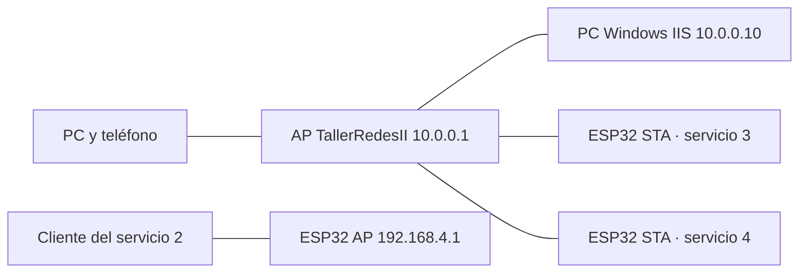
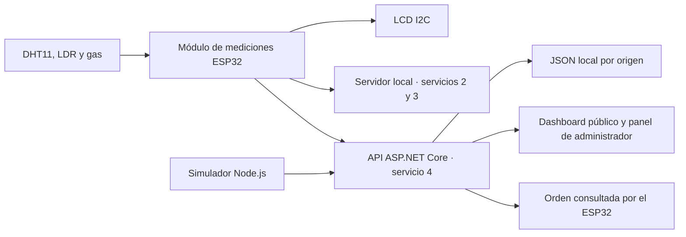
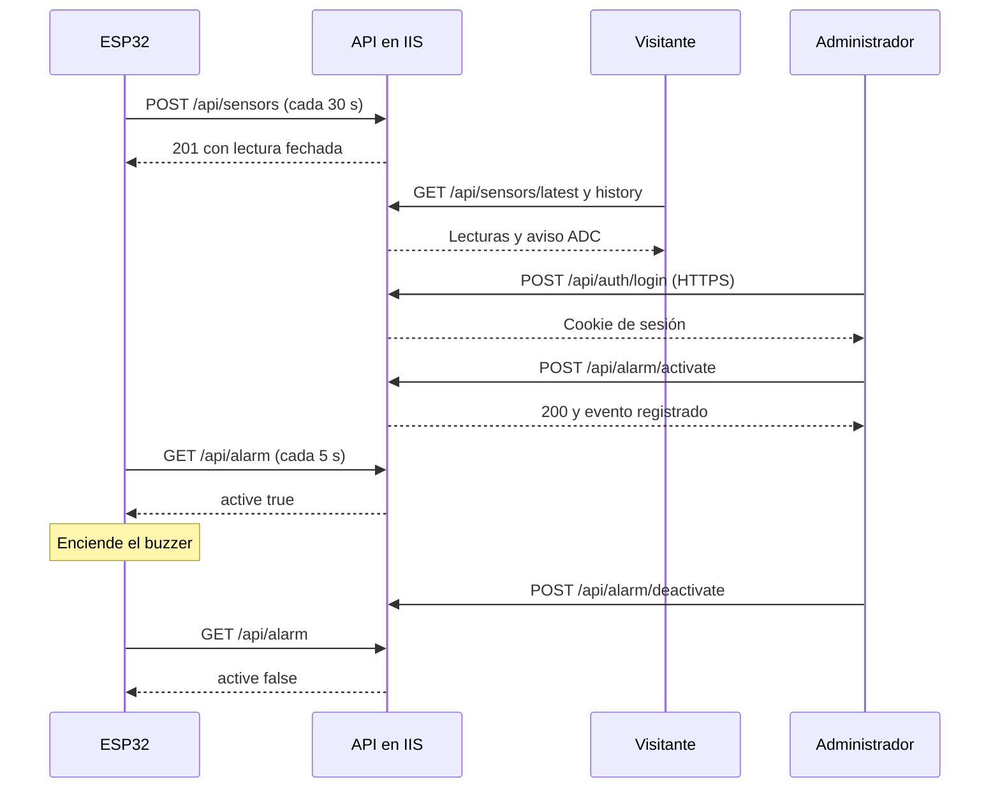

# Arquitectura del taller

Los servicios 2, 3 y 4 compilan las mismas fuentes con perfiles de PlatformIO. `Measurements` encapsula DHT11, ADC, LCD y JSON. `main.cpp` selecciona AP/STA y HTTP local o remoto. El dashboard vive en `wwwroot` para compartir origen con la API y publicarse en el mismo sitio IIS.

En los servicios 2 y 3, el cliente abre `GET /` y la página consulta `GET /api/sensors` cada 3 s. El servidor entrega 503 hasta disponer de la primera muestra y usa `null` para lecturas fallidas del DHT11.

El servicio 4 separa lecturas, alarma y auditoría entre los orígenes `device` y `simulator`. La API persiste un máximo de 2880 mediciones y 500 eventos por origen. Los endpoints históricos exponen hasta 240 lecturas y 100 eventos. La frescura depende de la hora de recepción en el servidor. El estado de alarma representa la orden guardada, ya que el protocolo no incluye acuse del buzzer.
